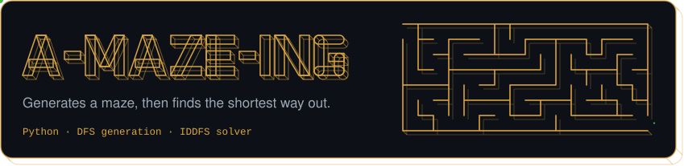

<picture><source media="(prefers-color-scheme: dark)" srcset="art/maze-dark.svg"><source media="(prefers-color-scheme: light)" srcset="art/maze-light.svg"></picture>

A maze generator and solver for the terminal. Python 3.10+, no runtime dependencies. Built at 42 with achafai.

## What it does

- Generates a maze from a small config file: perfect (one path between any two cells) or with loops.
- Finds the shortest path with iterative-deepening DFS.
- Draws everything in the terminal with a menu to regenerate, show the path and change colours.
- Ships the generator as a standalone package, `mazegen`.

## Run

```sh
make install
make run
```

## Use the generator

```python
from mazegen import MazeGenerator

gen = MazeGenerator(20, 15, (0, 0), (19, 14), perfect=True, seed=42)
gen.generate_maze()
grid = gen.get_structure()   # 4-bit wall mask per cell
path = gen.get_solution()    # shortest path, e.g. "SSEENE..."
```

## Config

`config.txt` takes `WIDTH`, `HEIGHT`, `ENTRY`, `EXIT`, `OUTPUT_FILE`, `PERFECT`, and an optional `SEED` for reproducible mazes.
